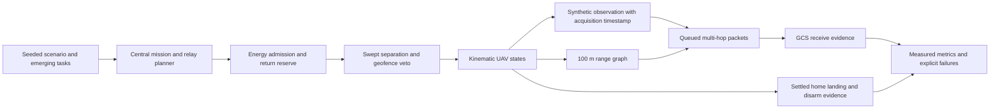

# AeroMesh UAV-X

A simulation-first UAV swarm project for the PUSHPAK UAV-X challenge. The current
entry point runs a sample-constraint profile with packet-level evidence and
explicit pass/fail checks. **This is an abstract kinematic PoC, not qualified
physical flight or a completed competition submission.**

The supplied problem PDF and sample-scenario slide govern the requirements.
See [requirements and assumptions](docs/UAVX_REQUIREMENTS.md),
[changes and known issues](docs/UAVX_CHANGELOG.md), and
[validation results](docs/UAVX_VALIDATION.md). Historical report/presentation
claims do not override fresh logs.
The [current failure register](docs/UAVX_FAILURES.md) separates observed fault-run
failures, unqualified assumptions, submission gaps and errors already corrected.
The [IIT Bombay action plan](docs/UAVX_NEXT_STEPS.md) prioritizes the remaining
engineering work against the published evaluation criteria and submission gates.

## Reproduce on Windows / Python 3.10

```powershell
python -m venv .venv
.venv\Scripts\python.exe -m pip install -r requirements-uavx.txt
.venv\Scripts\python.exe run_simulation.py --profile uavx --seed 42 --output evidence/run-42
.venv\Scripts\python.exe verify_submission.py evidence/run-42
```

On Linux/macOS use `.venv/bin/python` for the same commands. An output directory
must not already exist, preserving prior evidence. Runs advance simulation time
and finish faster than 45 wall-clock minutes. Each produces metrics, events,
packet outcomes, connectivity samples, and a JSONL trajectory. `--require-pass`
returns a failing exit status if the sample checks fail.

```powershell
.venv\Scripts\python.exe run_simulation.py --profile uavx --disturbance outage --output evidence/outage-42
.venv\Scripts\python.exe run_simulation.py --profile uavx --disturbance failure --output evidence/failure-42
.venv\Scripts\python.exe run_simulation.py --profile legacy --benchmark-all --output evidence/legacy-42
.venv\Scripts\python.exe -m pytest tests/test_mission_safety.py tests/test_uavx_profile.py tests/test_packet_evidence.py tests/test_evidence_metrics.py tests/test_submission_verifier.py tests/test_comm.py tests/test_route_recovery.py tests/test_interference.py tests/test_simulation.py -q
```

The legacy profile retains the old broad-range scenarios for regression. Their
coverage/latency numbers do not demonstrate compliance with the 100 m range
sample. `run_hardware.py` preserves the prior entry point; it is outside this
qualification and is never invoked by the UAV-X profile.

## Architecture



No ROS/PX4/ProjectAirSim adapter is claimed integrated into this profile. See the
requirements document for radio service, recharge, fleet-size, and geometry
assumptions. Existing third-party code/assets retain their applicable terms;
the original repository has no root LICENSE despite older MIT claims.

## Prepare the report and demo

Install the optional `requirements-artifacts.txt` dependencies and ffmpeg, then
pass completed run directories to the artifact builder:

```powershell
python scripts/build_uavx_submission.py --runs evidence/run-42 evidence/outage-42 evidence/failure-42 --output submission-artifacts/draft
```

This creates an eight-page technical draft, trajectory snapshot, and MP4 replay
from recorded states. Generated files and full run logs remain local and ignored.
The checked-in validation document records the exact benchmark results and source
fingerprints. Team details and organizer scenario/log compliance need final review
before any submission.
