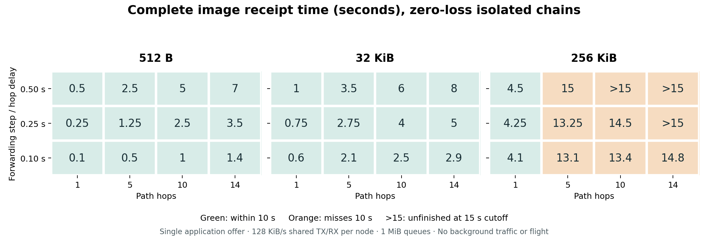

# Isolated radio sensitivity study

**Observed result:** the forwarding timestep strongly affects small-image completion, and a 256 KiB image misses the ten-second deadline on the tested multi-hop paths even with zero packet loss. Repeating the whole image every two seconds adds substantial traffic and queue drops; it does not improve those zero-loss completion times.

This is a research-only experiment using the unchanged `MeshRouter`. It is not a flight run, physical RF qualification, reliability estimate, or organizer benchmark.

## Reproducibility and scope

- Script: [radio_sensitivity.py](../radio_sensitivity.py).
- Results: [cases.jsonl](cases.jsonl); provenance and source hashes: [manifest.json](manifest.json).
- Command: `.venv\Scripts\python.exe -B research\uavx-20261106\radio_sensitivity.py --output research\uavx-20261106\radio-sensitivity-01 --max-wall-seconds 115`.
- Run: 2026-11-06 02:55:06–02:56:43 UTC; **240/240 cases**, **97.05 s** wall time.
- Production router SHA-256 before/after: `31ff5888dc11779edab0c1185b0eac2abe4e9d5510432d840567074340983b87`.
- Thirty UAV identities are declared. Only the selected logical chain radios participate; no vehicle motion, mission, charging, collision or landing is simulated. Declared adjacent links are no longer than 100 m in a static L-shaped geometry.
- Shared TX/RX service is 131,072 bytes/s per node, queues are 1,048,576 bytes, and the image chunk size is 512 raw bytes. Base64 and canonical JSON envelope bytes are charged.
- Parameters: dt=0.5/0.25/0.1 s; paths=1/5/10/14 hops; raw frames=512 B/32 KiB/256 KiB; attempt loss=0/0.02/0.1; one fixed seed=42.
- Application modes: single offer, or full-image offer every two seconds until the shared receiver completion flag is set. Both modes retain the router's intrinsic link retries.
- No background telemetry/control, ACK packets, route discovery, mobility, correlated interference, clock uncertainty or physical camera is simulated. The payload is a known byte array standing in for an already encoded image. Complete receipt requires all chunks, exact length and SHA-256.
- The 10 s deadline is fixed; observation continues to 15 s. Unfinished images are right-censored. No completion time beyond 15 s is invented.

The 216 normal cases form the 3×4×3×3×2 grid. The remaining 24 cases target one logical packet from a 32 KiB frame: all four intrinsic link attempts of its first application offer are forced to fail at the source. Later application copies use the baseline zero-loss channel. This is an explicitly scripted missing-chunk counterexample, not an estimate of a natural loss probability.

## Zero-loss completion time

Single application offer; all values seconds. “>15” means no complete image by the observation cutoff.

| Raw frame | dt | 1 hop | 5 hops | 10 hops | 14 hops |
|---|---:|---:|---:|---:|---:|
| 512 B | 0.50 | 0.50 | 2.50 | 5.00 | 7.00 |
| 512 B | 0.25 | 0.25 | 1.25 | 2.50 | 3.50 |
| 512 B | 0.10 | 0.10 | 0.50 | 1.00 | 1.40 |
| 32 KiB | 0.50 | 1.00 | 3.50 | 6.00 | 8.00 |
| 32 KiB | 0.25 | 0.75 | 2.75 | 4.00 | 5.00 |
| 32 KiB | 0.10 | 0.60 | 2.10 | 2.50 | 2.90 |
| 256 KiB | 0.50 | 4.50 | 15.00 | >15 | >15 |
| 256 KiB | 0.25 | 4.25 | 13.25 | 14.50 | >15 |
| 256 KiB | 0.10 | 4.10 | 13.10 | 13.40 | 14.80 |

The 512-byte frame contains one chunk and fits within one service interval. Its observed completion is exactly hops×dt. This confirms the model's hop-stage scheduling dependence. The study deliberately varies `hop_delay_s` together with dt, matching the mission constructor. It does **not** separate a physical propagation/service delay from a numerical scheduling step; doing so is a future model-design experiment.

At 32 KiB, payload serialization and per-hop scheduling both matter. At 256 KiB, all tested multi-hop cases fail the ten-second deadline, including dt=0.1 and zero loss. Reducing timestep does not make the large frame feasible under this service/scheduling setup.

## Full-image retry cost

Zero-loss, 14-hop examples. Offered bytes count the canonical JSON envelopes at packet offer, before multiplying by hops or intrinsic link retries.

| Frame / dt | Single-offer bytes | Full-retry bytes | Full-retry offers | Full-retry queue-overflow drops | Completion |
|---|---:|---:|---:|---:|---|
| 512 B / 0.50 s | 1,037 | 4,148 | 4 packets | 0 | 7.0 s in both modes |
| 32 KiB / 0.50 s | 66,540 | 266,346 | 256 packets | 0 | 8.0 s in both modes |
| 256 KiB / 0.50 s | 533,796 | 4,275,770 | 4,096 packets | 2,212 | Neither complete by 15 s |
| 256 KiB / 0.10 s | 533,796 | 4,275,770 | 4,096 packets | 2,225 | 14.8 s in both modes; deadline failed |

A frame can generate later duplicate traffic even after enough useful bytes are in flight. Under the current age/offer ordering in these selected cases, the original useful bytes still complete at the same time, while duplicates overflow queues. This experiment therefore establishes wasted capacity and drop inflation; it does not establish that full-image retry always delays the first useful image.

The current retry-stop feedback is an oracle: the source reads the receiver's shared completion state without an ACK packet. A selective-retry alternative must include reverse ACK/NACK bytes, timing, retransmission and loss before comparison.

## A single missing chunk invalidates image success

A 32 KiB frame has 64 chunks. In the scripted single-offer case, **63/64 logical packets arrive (98.4375% packet PDR)**, yet no complete image can be credited by 15 s. Its delivered unique chunk bytes are not a substitute for a hash-verified complete image.

Full-image retries recover the missing chunk, with the following selected outcomes:

| dt | Hops | Complete image | Total offered wire bytes | Single initial frame bytes |
|---|---:|---:|---:|---:|
| 0.50 s | 1 | 2.5 s | 132,990 | 66,476 |
| 0.50 s | 14 | 9.0 s | 332,960 | 66,540 |
| 0.25 s | 14 | 6.25 s | 266,346 | 66,540 |
| 0.10 s | 14 | 4.0 s | 133,118 | 66,540 |

This is a reason to evaluate selective repair, not proof that a particular new repair protocol will outperform the current one after feedback overhead.

## Loss sensitivity and interpretation

Across the 36 parameter combinations for each mode/loss level, the number completing by ten seconds was:

| Attempt loss | Single application offer | Full-image retries |
|---|---:|---:|
| 0 | 27/36 | 27/36 |
| 0.02 | 27/36 | 27/36 |
| 0.10 | 26/36 | 27/36 |

These fractions summarize deliberately different configurations; they are **not success-probability estimates**. Each cell uses one deterministic seed. Full retry changes the number/order of random draws, so equal seed is not an event-keyed common-random-number pairing. A reliability study needs multiple independent scenario/loss traces and matched exogenous events.

## Consequences for the project

1. Keep complete-image deadline success separate from logical-packet PDR, unique delivered chunk bytes and total delivered bytes.
2. Separate the intended radio timing model from numerical timestep in a future implementation; report both during convergence studies.
3. Budget actual serialized image and telemetry state, including reverse feedback. The successful nominal fixture carried only 14,357 raw image bytes across ten captures.
4. Compare full retry with selective repair using the same link/traffic history and explicit ACK transport, then add competing telemetry/control.
5. Sweep burst loss, asymmetric links, queue pressure and route churn before a ten-second claim. None is established by this isolated static-chain study.

